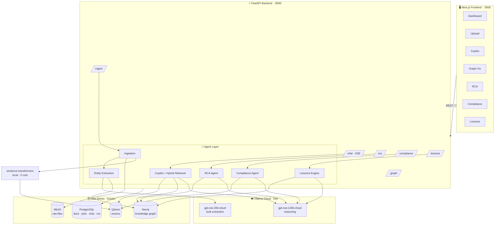

# System Architecture

## System Diagram (Mermaid — renders on GitHub)



## Ingestion Flow (Mermaid)

```mermaid
flowchart LR
    A[Upload file] --> B[Store raw → MinIO]
    B --> C[Parse<br/>PDF/XLSX/DOCX/EML/IMG+OCR]
    C --> D[Chunk<br/>512 tok · 50 overlap]
    D --> E[Embed locally<br/>MiniLM → Qdrant]
    E --> F[Extract entities<br/>gpt-oss:20b-cloud]
    F --> G[Build graph<br/>MERGE → Neo4j]
    G --> H[Job complete]
    style E fill:#1b3a2b,stroke:#6fa368
    style F fill:#3a2a18,stroke:#e8833a
    style G fill:#3a2a18,stroke:#e8833a
```



> **Hybrid retrieval** (copilot/RCA): a query hits **Qdrant** (semantic chunks) *and* **Neo4j**
> (graph context for detected asset tags) in parallel; results are fused into one grounded prompt.

---

## High-Level Overview (ASCII)

```
                        ┌──────────────────────────────────────┐
                        │           USER INTERFACES            │
                        │                                      │
                        │  Web Browser   │   Mobile Browser   │
                        └──────────────────────────────────────┘
                                         │
                                         │ HTTPS
                                         ▼
                        ┌──────────────────────────────────────┐
                        │         NEXT.JS FRONTEND             │
                        │         (Port 3000)                  │
                        │                                      │
                        │  Dashboard │ Upload │ Chat │ Graph   │
                        │  Compliance Dashboard │ RCA Reports  │
                        └──────────────────────┬───────────────┘
                                               │
                                               │ REST API / SSE
                                               ▼
┌──────────────────────────────────────────────────────────────────────────┐
│                         FASTAPI BACKEND (Port 8000)                       │
│                                                                           │
│  ┌──────────┐ ┌──────────┐ ┌──────────┐ ┌──────────┐ ┌───────────────┐  │
│  │ /ingest  │ │  /chat   │ │  /graph  │ │/complian-│ │    /rca       │  │
│  │  router  │ │  router  │ │  router  │ │   ce     │ │   router      │  │
│  └────┬─────┘ └────┬─────┘ └────┬─────┘ └────┬─────┘ └──────┬────────┘  │
│       │            │            │             │              │           │
│       └────────────┴────────────┴─────────────┴──────────────┘           │
│                                      │                                    │
│                           ┌──────────▼──────────┐                        │
│                           │    AGENT LAYER       │                        │
│                           │    (LangGraph)       │                        │
│                           │                      │                        │
│                           │ IngestionAgent       │                        │
│                           │ CopilotAgent         │                        │
│                           │ RCAAgent             │                        │
│                           │ ComplianceAgent      │                        │
│                           │ GraphBuilderAgent    │                        │
│                           │ LessonsAgent         │                        │
│                           └──────────┬───────────┘                        │
│                                      │                                    │
└──────────────────────────────────────┼────────────────────────────────────┘
                                       │
              ┌────────────────────────┼─────────────────────────┐
              │                        │                          │
              ▼                        ▼                          ▼
┌─────────────────────┐  ┌─────────────────────┐  ┌─────────────────────┐
│   OLLAMA CLOUD      │  │    DATA STORES       │  │   FILE STORAGE      │
│  (free, hosted,     │  │                      │  │                     │
│   OpenAI-compatible)│  │  Neo4j (Port 7687)   │  │  MinIO (Port 9000)  │
│                     │  │  - Knowledge Graph   │  │  - PDFs             │
│ gpt-oss:120b        │  │  - Entity nodes      │  │  - Images           │
│ - Copilot chat      │  │  - Relationships     │  │  - Documents        │
│ - RCA analysis      │  │                      │  │                     │
│ - Compliance        │  │  Qdrant (Port 6333)  │  └─────────────────────┘
│                     │  │  - Vector embeddings │
│ gpt-oss:20b         │  │  - Semantic search   │
│ - Entity extract    │  │                      │
│ - Classification    │  │  PostgreSQL (5432)   │
│ - Summarization     │  │  - Documents table   │
└─────────────────────┘  │  - Jobs table        │
                         │  - Sessions table    │
                         │  - Chat history      │
                         └─────────────────────┘
```

---

## Data Flow: Document Ingestion

```
User uploads file
       │
       ▼
FastAPI /ingest/upload
       │
       ├─→ Store raw file → MinIO
       │
       ├─→ Create job record → PostgreSQL (status: pending)
       │
       ▼
IngestionAgent (LangGraph)
       │
       ├─→ Parse document
       │     ├─ PDF text → PyPDF2
       │     ├─ PDF scanned → PaddleOCR
       │     ├─ Excel → pandas
       │     ├─ Image → PaddleOCR
       │     ├─ Email → email library
       │     └─ DOCX → python-docx
       │
       ├─→ Chunk text (512 tokens, 50 overlap)
       │
       ├─→ Embed chunks → sentence-transformers → Qdrant
       │
       ├─→ Extract entities (Ollama Cloud gpt-oss:20b)
       │     └─ Equipment tags, persons, dates, params, regulations
       │
       ├─→ Build graph nodes/edges → Neo4j
       │     └─ Cross-link with existing entities
       │
       └─→ Update job status → PostgreSQL (status: complete)
```

---

## Data Flow: Expert Knowledge Copilot

```
User sends query
       │
       ▼
FastAPI /chat (SSE stream)
       │
       ▼
CopilotAgent (LangGraph)
       │
       ├─→ Classify query type (equipment/procedure/failure/compliance)
       │
       ├─→ Hybrid Retrieval:
       │     ├─ Qdrant: semantic search → top-k relevant chunks
       │     └─ Neo4j: extract entities in query → graph context
       │
       ├─→ Merge & rerank context
       │
       ├─→ Build prompt with context + citations
       │
       ├─→ Ollama Cloud gpt-oss:120b → stream response
       │
       └─→ Return answer + source citations + confidence score
```

---

## Data Flow: Maintenance RCA

```
User triggers RCA for asset/incident
       │
       ▼
RCAAgent (LangGraph)
       │
       ├─→ Pull asset history from Neo4j
       │     └─ All docs related to asset tag
       │
       ├─→ Semantic search failure patterns in Qdrant
       │
       ├─→ Retrieve OEM manuals, maintenance records
       │
       ├─→ Ollama Cloud gpt-oss:120b: structured RCA generation
       │     ├─ Immediate cause
       │     ├─ Contributing factors
       │     ├─ Root causes
       │     ├─ Recommendations
       │     └─ Similar past incidents
       │
       └─→ Store RCA report → PostgreSQL + return to user
```

---

## Knowledge Graph Schema

### Node Types

```
(:Equipment {
  tag: "P-101",
  name: "Centrifugal Pump",
  type: "Pump",
  location: "Unit 3",
  manufacturer: "...",
  install_date: "...",
  last_service: "..."
})

(:Document {
  id: "uuid",
  title: "...",
  type: "maintenance_report|safety_procedure|...",
  date: "...",
  file_path: "...",
  summary: "..."
})

(:Incident {
  id: "uuid",
  date: "...",
  severity: "high|medium|low",
  description: "...",
  status: "open|closed"
})

(:Person {
  name: "...",
  role: "engineer|operator|inspector",
  department: "..."
})

(:Regulation {
  code: "OISD-118",
  name: "...",
  authority: "...",
  version: "..."
})

(:Procedure {
  id: "uuid",
  name: "...",
  type: "startup|shutdown|maintenance|emergency",
  revision: "..."
})

(:Location {
  name: "Unit 3",
  type: "plant|unit|area",
  parent: "..."
})
```

### Relationship Types

```
(Equipment)-[:HAS_INCIDENT]->(Incident)
(Equipment)-[:MAINTAINED_BY]->(Person)
(Equipment)-[:LOCATED_AT]->(Location)
(Equipment)-[:REFERENCED_IN]->(Document)
(Document)-[:DESCRIBES_PROCEDURE]->(Procedure)
(Document)-[:REFERENCES_REGULATION]->(Regulation)
(Incident)-[:CAUSED_BY]->(Equipment)
(Incident)-[:INVESTIGATED_BY]->(Person)
(Incident)-[:SIMILAR_TO]->(Incident)
(Procedure)-[:REQUIRED_BY]->(Regulation)
(Person)-[:AUTHORED]->(Document)
```

---

## LLM Usage Optimization (Ollama Cloud — Free Tier)

All inference runs on free Ollama cloud models via the `openai` Python client, pointed by default at the **local Ollama daemon** (`http://localhost:11434/v1`), which proxies `*-cloud` models to Ollama's servers. Two model tiers keep us under free-tier request caps:

| Operation | Model | Avg Tokens | Frequency |
|---|---|---|---|
| Entity extraction per chunk | gpt-oss:20b-cloud | ~800 | High (every doc) |
| Query classification | gpt-oss:20b-cloud | ~200 | High (every chat) |
| Document summarization | gpt-oss:20b-cloud | ~1500 | Medium |
| Copilot chat response | gpt-oss:120b-cloud | ~2000 | Medium |
| RCA generation | gpt-oss:120b-cloud | ~4000 | Low |
| Compliance analysis | gpt-oss:120b-cloud | ~3000 | Low |
| Lessons pattern discovery | gpt-oss:120b-cloud | ~3000 | Low |

**Caching Strategy:**
- Entity extraction: cache by SHA256 hash of document chunk
- Compliance gaps: cache per document version
- RCA reports: cache per asset + date range
- Chat: no caching (conversational context changes)

---

## Docker Compose Services

```yaml
services:
  backend:     FastAPI (port 8000)
  frontend:    Next.js (port 3000)
  postgres:    PostgreSQL 16 (port 5432)
  neo4j:       Neo4j Community (ports 7474, 7687)
  qdrant:      Qdrant (ports 6333, 6334)
  minio:       MinIO (ports 9000, 9001)
```

One command to start everything: `docker-compose up -d`

---

## Security Considerations

- Ollama Cloud API key stored only in environment variables, never in code
- MinIO credentials are internal Docker network only
- Neo4j auth enabled
- CORS restricted to frontend origin in production
- File uploads: MIME type validation + size limits (100MB max)
- SQL injection: prevented by SQLAlchemy ORM
- Prompt injection: system prompt isolation + input sanitization
